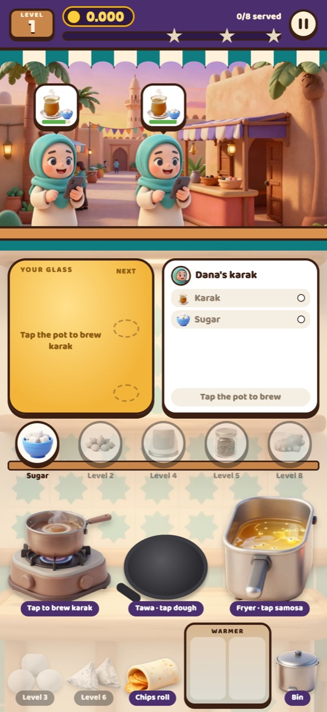
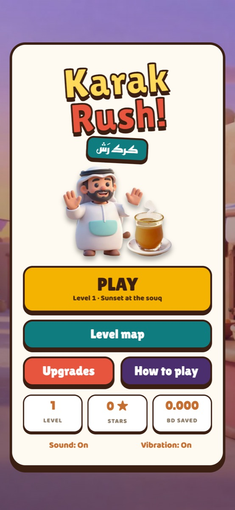

<div align="center">




# Karak Rush · كرك رش

**A time-management cooking game at a karak stall in Bahrain. Brew, pour, fry and serve before your customers walk away.**

    

[**▶ Play now**](https://karak-rush.vercel.app)

</div>


Customers line up at your window with order bubbles. You brew karak, pour cups, add sugar and spices, cook paratha and samosa before they burn, and collect your fils. It plays on a phone, a tablet or a desktop, and installs to your home screen.

## How to play
- **Karak:** tap the pot to brew, tap again to pour a glass. Add sugar, spices and ice to the glass on your tray, and the order card shows what's still missing.
- **Paratha & chicken roll** cook on the tawa, **samosa** in the fryer. Tap them when they glow, before they burn. **Chips roll** and **balaleet** are ready straight away. Extra food waits in the **warmer**.
- Serve everything in a bubble to get paid. Faster service means bigger tips, and customers who wait too long walk away.
- Tap the coins on the counter. Earn enough for 1–3 stars to unlock the next level.

## Art
Soft-3D characters, food, kitchen equipment and backgrounds were generated with AI (Higgsfield, Z Image model), then cut out and optimised to WebP (about 0.5 MB in total) in `img/`.

## Features
- **4 places, 48 levels:** Manama Souq, Muharraq old town, the Corniche and Sakhir desert camp, 12 levels each, 1–3 stars per level.
- **10 customer types:** the souq regulars plus a construction worker, a delivery rider in a hurry, a big-tipping tourist, a very patient grandma and a VIP who tips 3× but hates waiting.
- **A growing menu:** karak with sugar, cardamom, milk, saffron, ginger and ice, plus chips roll, paratha, samosa, chicken roll and balaleet.
- **Endless Rush:** customers keep coming, faster and faster, until 3 walk off. Beat your best.
- **Special nights:** Ramadan Night and National Day. They pay double when the real date comes around.
- **Shop:** kitchen upgrades and 8 decorations that show up on your stall, each with a small bonus. Boosts for a single round.
- **Daily gift** that grows over 7 days, and **21 achievements** with coin rewards.
- **Plays upright or sideways:** turn the phone and the stall rearranges, with customers and cooking on the left and your glass, ingredients and supplies on the right.
- Customer voices, Web Audio sound effects (no audio files), vibration, pause, progress saved on the device, and installable to the home screen.

## Project structure
```
index.html            page shell: HUD, street & counter, kitchen stations
css/style.css         all styling
js/data.js            menu, prices, levels, upgrades and art file names
img/                  characters, food, equipment and backgrounds (WebP)
js/storage.js         saved progress (localStorage)
js/audio.js           synthesised sound effects + vibration
js/main.js            level generation, customers, kitchen logic, screens, main loop
sw.js                 offline cache
manifest.webmanifest  home-screen install
icons/                app icons
```

## Deploy
Static site with no build step. Import the repo on [vercel.com/new](https://vercel.com/new) with the default settings, or open `index.html` through any static server.

---

<div align="center">

Built by **Hasan Abdulla** · [github.com/hx03s](https://github.com/hx03s) · Bahrain 🇧🇭

</div>
